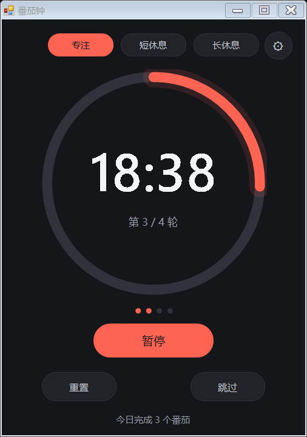
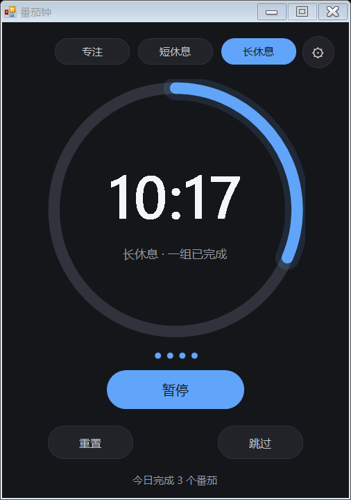
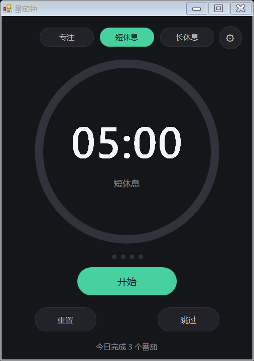
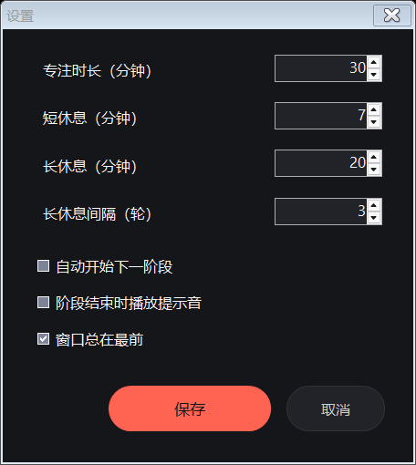

# 番茄钟（Pomodoro）

一个 Windows 桌面番茄钟，C# WinForms 单文件实现，无第三方依赖，编译后为单个 exe。

## 下载运行

不想编译？到 [Releases](https://github.com/zy2026g-web/pomodoro/releases/latest) 下载 `Pomodoro.exe`，双击即可运行（Windows 10/11 自带 .NET Framework 4.x）。



## 功能

- 专注 / 短休息 / 长休息三种阶段，按番茄工作法自动衔接
- 每完成 N 个番茄进入长休息（N 可配置）
- 环形进度条、剩余时间、今日完成数一目了然
- 阶段结束时：托盘气泡通知 + 提示音 + 任务栏闪烁
- 常驻系统托盘，最小化后继续计时，双击托盘图标唤回窗口
- 设置与今日完成数保存到 `%APPDATA%\Pomodoro\settings.ini`，跨天自动清零

## 快捷键

| 按键 | 作用 |
| --- | --- |
| 空格 | 开始 / 暂停 |
| R | 重置当前阶段 |
| S | 跳过当前阶段 |

窗口激活时生效。

## 编译

需要 Windows 自带的 .NET Framework 4.x，用系统 `csc.exe` 直接编译：

```bat
C:\Windows\Microsoft.NET\Framework64\v4.0.30319\csc.exe /target:winexe /codepage:65001 ^
  /out:Pomodoro.exe /win32icon:app.ico ^
  /r:System.Windows.Forms.dll /r:System.Drawing.dll /optimize+ Pomodoro.cs
```

自测（渲染预览图、校验设置解析与状态机）：

```bat
Pomodoro.exe --selftest preview
```

结果写入 `preview/selftest.txt`。仓库不包含编译产物 `Pomodoro.exe`，按上面的命令自行生成。

## 文件说明

| 文件 | 说明 |
| --- | --- |
| `Pomodoro.cs` | 全部逻辑与自绘控件（约 1300 行） |
| `app.ico` | 应用图标，由 `Pomodoro.exe --makeicon app.ico` 生成 |
| `使用说明.txt` | 面向使用者的操作说明 |
| `preview/` | 界面预览图与自测输出 |

## 预览

| 专注 | 长休息 | 空闲 |
| --- | --- | --- |
|  |  |  |


